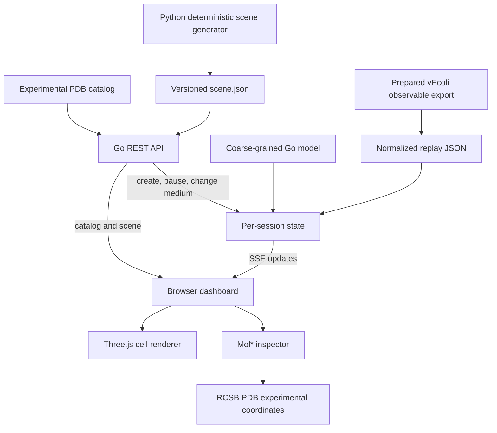

# Architecture and scalability path

## First vertical slice (delivered)

There are **two explicit coordinate systems**: procedural whole-cell renderer
units and experimentally solved atomic coordinates (Ångstroms) from PDB. The
first is not calibrated to the second by simply multiplying coordinates.

## Next scalable version

1. **Asset processing:** move ingestion/packing/LOD material generation to
   isolated container jobs (Argo Workflows or other orchestration). Write
   content-addressed, versioned files with checksums, accession and strain
   references to object storage.
2. **Simulation:** launch pinned vEcoli jobs with validated configurations via
   Nextflow in controlled workers. Store Parquet timeseries and metadata;
   normalize selected observables with explicit unit conversion and provenance.
3. **Orchestration:** durable simulation store with a state machine
   `queued → running → completed|failed|canceled`, idempotency keys, graceful
   termination and retry rules.
4. **Live data:** use a queue (NATS/Kafka) for job events and a per-run
   snapshot store; SSE/WS gateways fan out low-rate summarized changes.
   Do not stream per-atom trajectories through application events.
5. **Viewer:** binary LOD scene assets and lazy Mol* inspection; preserve
   compressed volume tiles separately and only load what the camera needs.
6. **Security:** SSO, RBAC, private dataset ACL, file validation, upstream
   rate limits, admission quotas, audit logging, encrypted object storage.
7. **Validation:** compare spatial priors against Cryo-ET and super-resolution
   datasets; compare model observables to condition-matched experimental
   datasets with uncertainties and versioned acceptance criteria.
8. **Observability:** queue lag, job starts/completions, memory/GPU consumption,
   browser frame-time percentiles, error rates, and data lineage trace IDs.

### Independent scaling targets

| Workload | Scaling | Storage |
|---|---|---|
| HTTP API | Stateless replicas; auth and metadata | PostgreSQL |
| SSE gateway | By concurrent active connections | Snapshot cache + messaging |
| Geometry workers | CPU parallel batch jobs | Object storage |
| vEcoli workers | CPU batch scheduling | Parquet + provenance |
| Atomistic simulations | GPU jobs on demand | Trajectory chunks |
| Web content | Static edge cache | Immutable asset manifests |

## API v1

- `GET /api/healthz` — health and active educational model ID
- `GET /api/catalog` — curated molecular catalog and PDB accessions
- `GET /api/scene` — deterministic geometry/instance manifest
- `GET /api/replay/info` — server-configured replay source metadata
- `POST /api/simulations` — `{ "medium": "rich", "mode": "live"|"replay" }`
- `GET /api/simulations/{id}` — snapshot
- `POST /api/simulations/{id}/actions` — `start`, `pause`, `reset`, `set_medium`
- `GET /api/simulations/{id}/events` — SSE `event: state` with JSON snapshot
- `DELETE /api/simulations/{id}` — terminate session

There are no cross-service contracts yet: `data/*.json` and the Go `Snapshot`
struct are the **v1 schema**. Before splitting repositories, generate stable
OpenAPI/JSON Schema definitions (and optionally Protobuf) from a single source
of truth and add compatibility tests.
